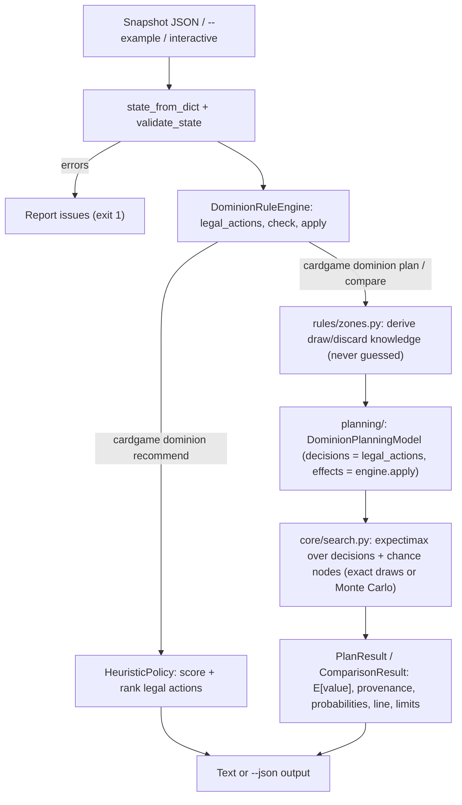

# Card Game Rule Engine

An **offline**, deterministic **rule engine** for card games with transparent, explainable
**decision policies** on top. It's built so an AI agent and more card games can be added later
without touching existing rule logic.

| Game | Ruleset | Status |
|------|---------|--------|
| `dominion` | Dominion Second Edition, Base Set, 2–4 players | V1 - rule engine + heuristic policy + CLI; Phase 2 - probabilistic lookahead planner; Phase 2b - session tracking & belief state |

For Dominion, describe your current turn (or load a JSON snapshot) and it will:

1. check the snapshot against the official rules,
2. list every legal move (and explain why other moves are illegal),
3. rank the legal moves with a heuristic policy you can inspect line by line,
4. show a plan for the rest of the phase, a confidence level, and what it doesn't know,
5. or (Phase 2) look ahead through the rest of the turn with exact draw probabilities when you tell it
   what is in your draw and discard piles (`cardgame dominion plan` / `compare`),
6. or (Phase 2b) track a real game turn by turn from the starting deck: you enter only what it cannot
   deduce, and it keeps an exact belief about your hidden cards (`cardgame dominion session ...`).

No internet, API, or LLM is used at runtime. All rule and card data is bundled in the package.
Dominion rule research sources and dates: [`docs/RULES_RESEARCH.md`](docs/RULES_RESEARCH.md).


The flowchart shows the V1 path. With the Phase 2 planner the runtime looks like this:



---

## Quick start

Requires **Python 3.10+**. No runtime dependencies (standard library only).

```bash
git clone <your-repo-url> card-game-rule-engine
cd card-game-rule-engine

python -m venv .venv
# macOS/Linux:
source .venv/bin/activate
# Windows (PowerShell):
.venv\Scripts\Activate.ps1

pip install -e ".[dev]"        # installs the `cardgame` CLI + pytest
```

Try it:

```bash
cardgame games                                             # list supported games
cardgame dominion examples                                 # list bundled example snapshots
cardgame dominion recommend --example village_smithy_action
cardgame dominion recommend --example endgame_penultimate_province
cardgame dominion plan --example stranded_draw_vs_money       # lookahead planner (Phase 2)
cardgame dominion interactive                              # build a snapshot by answering questions
cardgame dominion session interactive game.json            # track a real game turn by turn (Phase 2b)
pytest                                                     # run the test suite
```

Without installing, you can also run from the repo root:

```bash
PYTHONPATH=src python -m card_game_engine dominion recommend --example opening_5_2        # macOS/Linux
$env:PYTHONPATH="src"; python -m card_game_engine dominion recommend --example opening_5_2  # PowerShell
```

> Offline install: if the machine has no internet, use `pip install --no-build-isolation -e .`
> (needs `setuptools` already installed). Tests need `pytest`.

---

## Commands (Dominion)

All game commands are `cardgame <game> <command>`; `cardgame games` lists games.

| Command | What it does |
|---------|--------------|
| `cardgame dominion recommend STATE.json` | Best move + alternatives with reasons. `--json`, `--top N`, `--brief`, `--example NAME`, `-` for stdin |
| `cardgame dominion legal STATE.json --explain` | Legal moves, and why each unaffordable/empty buy is illegal |
| `cardgame dominion validate STATE.json` | Rule-consistency check (exit code 1 if invalid) |
| `cardgame dominion interactive [--save s.json] [--load s.json]` | Step-by-step snapshot builder, then live turn assistant |
| `cardgame dominion examples [--show NAME]` | List examples / print one as a template |
| `cardgame dominion cards [NAME] [--kingdom]` | Browse the verified card registry (with sources) |
| `cardgame dominion sources` | Research sources and dates |
| `cardgame dominion plan STATE.json` | Lookahead planner: next action by expected value with exact draw odds (see [below](#lookahead-planner-phase-2)) |
| `cardgame dominion compare STATE.json [--actions LABEL ...]` | Every legal first action (or the listed ones) evaluated side by side by the planner |
| `cardgame dominion session <verb> FILE ...` | Track a real game across turns: record events, deduce hidden cards, predict hands, plan (see [below](#session-tracking--belief-state-phase-2b)) |

Example output:

```
>> RECOMMENDED: Play Throne Room on Smithy    [confidence: high]
     [+4.5] Smithy #1: +3 card(s) drawn.
     [+4.5] Smithy #2: +3 card(s) drawn.
     Throne Room: the doubled card does not use Actions.
     Uses your last Action: Moneylender will stay in hand.

Alternatives:
   2. Play Throne Room on Moneylender              score    5.40
   3. Play Smithy                                  score    4.50

Plan for this phase: Play Throne Room on Smithy -> Then: Draw 6 card(s) and add them
to your hand before continuing. Re-run the recommendation with your new hand.
```

### Interactive mode

`cardgame dominion interactive --save game.json` asks about player count, kingdom (the rulebook's
First Game set or your own 10 cards) and your turn number.

- **Turn 1 or 2: quick start.** You still hold the starting 7 Copper + 3 Estate, so it only asks how
  many Coppers are in your hand (and, on turn 2, what you bought on turn 1).
- **Later turns:** changed Supply piles, hand, cards already played, your deck (starting deck +
  changes like `+Silver x2, -Estate`) and opponents' VP. Coins are asked only if you have already
  played cards: Treasures still in your hand are added when the tool plays them.

It then recommends a move. Press Enter to apply it (or type an option's number). If the move draws
cards, it asks what you drew. If a card needs your choices (Chapel, Remodel, Witch's attack...),
it lists the steps and asks for the result. It never guesses.

When your turn ends it asks what each opponent gained or trashed (e.g. `Province`, `-Estate`; blank =
nothing), whether you gained anything on their turns (e.g. `+Curse`), and your new hand, then keeps
going until the game ends. Supply piles and opponents' VP update from what you enter; the kingdom,
your deck and a per-turn list of what you bought carry over. With `--save` the game is written after
every turn, so you can stop and resume with `cardgame dominion interactive --load game.json --save game.json`.

To try a game already in progress:

```bash
cardgame dominion examples --show saved_game_turn_3 > game.json
cardgame dominion interactive --load game.json --save game.json
```

---

## Snapshot format (schema v1)

Only `num_players`, `kingdom` and `player.hand` / `player.phase` are required. Anything
omitted is treated as **unknown** and reported as such. It is never made up.

```jsonc
{
  "schema_version": 1,
  "num_players": 2,                        // 2-4
  "turn_number": 9,                        // optional
  "kingdom": ["Cellar", "Chapel", "Village", "Smithy", "Throne Room",
              "Moneylender", "Festival", "Laboratory", "Market", "Witch"],
  "supply": {"Province": 8, "Curse": 6},   // optional; missing piles are assumed full (flagged)
  "trash": ["Copper"],                     // optional
  "player": {
    "phase": "buy",                        // "action" | "buy" ("turn_over" in saved games)
    "hand": ["Gold", "Silver", "Copper", "Copper", "Estate"],   // or {"Copper": 2, ...}
    "in_play": [],                         // cards already played this turn
    "actions": 1, "buys": 1, "coins": 0,   // current remaining resources
    "bought_this_turn": [],
    "owned_cards": {"Copper": 7, "Estate": 3, "Silver": 3, "Gold": 1, "Witch": 1},  // optional: whole deck
    "deck_count": 4, "discard_count": 8     // optional
  },
  "opponents": [{"name": "Opponent", "vp": 0}],  // optional; vp or owned_cards
  "history": [{"turn": 1, "hand": ["Copper", "Copper", "Copper", "Estate", "Estate"], "bought": ["Silver"]}]
                                           // optional; written by `interactive --save`
}
```

Tip: `cardgame dominion examples --show witch_midgame_buy > my_turn.json` gives you a template.
For the lookahead planner you can also describe your draw and discard piles (`player.draw_pile`,
`player.discard_pile`) and a default horizon (`planning`), see [Lookahead planner](#lookahead-planner-phase-2).

### Bundled examples

| Name | Situation |
|------|-----------|
| `opening_5_2` | Turn 1, five Coppers |
| `village_smithy_action` | Action sequencing (Village before Smithy) |
| `throne_room_moneylender` | Which card to Throne |
| `witch_midgame_buy` | $7 with a Witch kingdom: Witch vs Gold (low-confidence close call) |
| `multi_buy_festival` | 3 Buys, $10 to split (3-player) |
| `endgame_penultimate_province` | $8 but behind: Penultimate Province Rule → Duchy |
| `endgame_winning_province` | Last Province wins the game |
| `three_pile_ending` | Ending the game on piles while ahead |
| `unknown_deck_minimal` | Minimal info: shows how uncertainty is reported |
| `saved_game_turn_3` | Saved 3-player game with turn history: continue it in interactive mode |
| `small_deck_village_smithy` | Planner: known 5-card draw pile, Village→Smithy E[$]=5.20 vs Smithy first 4.40 |
| `stranded_draw_vs_money` | Planner: draw pile of Estates, Militia ($5) beats Smithy ($3); the heuristic picks Smithy |
| `ordered_deck_known` | Planner: fully known draw order, Village→Smithy reaches exactly $8 |
| `reshuffle_next_hand` | Planner, `next_hand` horizon: the next hand reshuffles a known discard pile |
| `partial_knowledge` | Planner: known top card + unknown cards, values reported as lower bounds |

---

## What V1 supports

**Rules (verified against the publisher's 2E rulebook):** setup pile sizes for 2–4 players;
Action → Buy → Clean-up; Action/Buy accounting; coin pooling across Buys; $0 buys; the 2E rule
that **Treasures cannot be played after buying**; empty piles; game end (Provinces empty or 3
piles empty, checked at end of turn); VP including Gardens.

**Cards:** all 7 basic cards and all 26 Base Set 2E Kingdom cards are in the registry with cost,
types and effects. Support level per card (`cardgame dominion cards`):

- **full**: deterministic effects applied automatically (Village, Smithy, Laboratory, Market,
  Festival, Moat, Merchant's Silver bonus, Moneylender's trash choice, all Treasures/Victory cards)
- **partial**: numeric part automated, the rest is a manual step (Witch, Militia, Throne Room,
  Library, Poacher, Bandit, Bureaucrat, Council Room, Cellar, Harbinger, Vassal, Sentry)
- **manual**: Chapel, Workshop, Remodel, Mine, Artisan (the engine asks you for the result)

Draws are always **pending** until you say what you drew. That's hidden information.

**Not supported in V1:** 5–6 players, expansions, opponents' turns and Moat reactions,
deck tracking / shuffle inference (the Phase 2 planner uses draw/discard piles you describe,
but does not track them across turns). See [`docs/RULES_RESEARCH.md`](docs/RULES_RESEARCH.md).

## How the Dominion heuristic policy decides

Scores are sums of **named components** printed next to each option, e.g.
`[+14.0] Province baseline value in the endgame stage` and
`[-8.0] Penultimate Province Rule: ...`. The components are:

- game **stage** (early → mid → dance → late → endgame) from Provinces left and pile pressure
- basic-card values by stage (Big-Money-style buy rules)
- a 0–10 Kingdom strength rating, discounted late in the game
- deck fit: terminal collision, villages without terminals, duplicates, Curses left for Witch, etc.
- endgame safety: winning/losing game-ending buys, Penultimate Province Rule, 3-pile warnings
- Action-phase sequencing: non-terminals before terminals, value of draws/coins/buys/attacks

All numbers live in [`src/card_game_engine/games/dominion/policy/weights.py`](src/card_game_engine/games/dominion/policy/weights.py).
They are **heuristics, not rules**. Confidence comes from the score gap to the next option. It
drops when the deck or scores are unknown. Every output lists its uncertainties.


## Lookahead planner (Phase 2)

`cardgame dominion plan` looks ahead through the rest of your turn (optionally until your next hand is
drawn) and picks the action with the best **expected value**. Card effects come only from the rule
engine (`legal_actions` / `apply`); the planner adds **chance nodes** for draws, whose outcomes it
enumerates exactly (multivariate hypergeometric, grouped by multiset), including the reshuffle when
the draw pile runs out. It falls back to seeded Monte Carlo sampling only when a draw has more than
200 distinct outcomes. It never invents hidden cards: a card of unknown identity stays `"?"`.

### Describing your piles (snapshot fields, all optional)

```jsonc
"player": {
  ...,
  "draw_pile":    {"order": ["Gold", "Estate", "Silver"]}                    // order known, top first
               |  {"composition": {"Copper": 3, "Estate": 2}}                 // cards known, order unknown
               |  {"top": ["Gold"], "composition": {"Copper": 2}, "unknown_count": 2},  // partial
  "discard_pile": {"composition": {"Copper": 2}, "unknown_count": 0}
},
"planning": {"horizon": "turn"}          // or "next_hand" / "hands:N" (1-4): default horizon for the planner
```

Without `draw_pile`, the planner derives what it can by exact subtraction (`owned_cards` minus hand,
play and a known discard pile), else uses `deck_count` as that many unknown cards. The derivation is
reported in the output. The **information level** of the draw pile is one of:

| Level | Meaning |
|---|---|
| `fully_known_order` | the whole draw pile order is known: draws are deterministic |
| `known_composition` | the cards are known, the order is not (a known top prefix is allowed) |
| `partially_known` | some cards are unknown (`unknown_count > 0`, or only `deck_count`) |
| `insufficient` | the draw pile size is unknown: draws stop at a boundary |

### Objectives and provenance labels

| `--objective` | Value | Kind |
|---|---|---|
| `money` (default) | E[coins generated this turn] (coins left + cost of cards bought) | exact; does **not** judge which card you buy |
| `threshold:N` | P(at least $N this turn) | exact probability |
| `next_hand_money` | E[coins in the hand drawn after Clean-up] (needs horizon `next_hand` or `hands:N`) | exact |
| `future_money` | E[total Treasure coins over the N projected hands] (horizon `hands:N`) | exact (Monte Carlo over budget; `?` = $0, lower bound) |
| `purchase` | heuristic value of the cards bought (V1 policy weights) | heuristic score, not coins or a probability |

Every value carries a provenance label: `exact` (no randomness), `expected` (probability-weighted
over an exact enumeration), `monte_carlo` (sampled estimate, shown `± stderr`), `heuristic`,
`lower_bound` (the line can reach cards of unknown identity, counted as $0; shown as `>=`) or
`partial` (a player choice the planner does not model, e.g. Workshop's gain, evaluated as if it did
nothing). Threshold probabilities are labelled the same way. When the recommended action beats an
alternative whose value is a lower bound or partial, the output says the comparison is **not
conclusive**.

**Horizons.** `turn` (default) stops at your Clean-up. `hands:N` (1 <= N <= 4; `next_hand` = `hands:1`)
also projects your next N start-of-turn hands with **no decisions in future turns**: each projected
hand goes to the discard pile at its Clean-up and the next one is drawn, reshuffling by the rules.
Per projected hand the output reports E[$] and P(hand >= $5).

**Ties.** When the best and second-best candidates have equal value under the objective (|delta| <= 1e-9),
the result says so (`tie: true`, `tied_actions`, `>> TIE ...`) instead of presenting an arbitrary winner:
the decision is beyond that objective/horizon. Example (real output, trimmed) on this turn-1 snapshot
`t1.json` (First Game Kingdom listed as 10 names, elided here):

```json
{"num_players": 2, "turn_number": 1, "kingdom": ["Cellar", "...", "Workshop"],
 "player": {"phase": "buy", "hand": ["Estate"], "in_play": ["Copper", "Copper", "Copper", "Copper"], "coins": 4,
            "owned_cards": {"Copper": 7, "Estate": 3},
            "draw_pile": {"composition": {"Copper": 3, "Estate": 2}}, "discard_pile": {"composition": {}}}}
```

```text
$ cardgame dominion compare t1.json --horizon next_hand --objective next_hand_money --actions "Buy Silver" "End turn (Clean-up)"
>> TIE under objective next_hand_money (horizon next_hand): Buy Silver, End turn (Clean-up)    E[next-hand $] = 3.00
   No difference under this objective/horizon - the decision is beyond it (try another objective or a longer horizon).

$ cardgame dominion compare t1.json --horizon hands:2 --objective future_money --actions "Buy Silver" "End turn (Clean-up)"
>> RECOMMENDED: Buy Silver    E[future $] = 7.09 [expected; search exact]
   1. Buy Silver                                   E[future $] = 7.09            [expected; search exact]
          hand 1: E[$] = 3.00, P($>=5) = 0.00  (exact)
          hand 2: E[$] = 4.09, P($>=5) = 0.35  (exact)
   2. End turn (Clean-up)                          E[future $] = 6.50            [expected; search exact]
          hand 1: E[$] = 3.00, P($>=5) = 0.00  (exact)
          hand 2: E[$] = 3.50, P($>=5) = 0.08  (exact)
```

The next hand is already fixed (the 5 cards left on the draw pile), so the Silver only shows up in
hand 2, after the reshuffle.

### Examples (actual output, trimmed)

```text
$ cardgame dominion plan -e stranded_draw_vs_money
Horizon: turn    Method: exact enumeration of draws
Information level: known_composition
>> RECOMMENDED: Play Militia    E[$] = 5.00 [exact; search exact]
     Threshold probabilities: P($>=5)=1.00, P($>=6)=0.00, P($>=8)=0.00  (exact)
     Top future outcomes (exact):
       p=1.00  coins=$5, bought Duchy
     Principal line: Play Militia -> End Action phase (go to Buy phase) -> Play all Treasures -> Buy Duchy -> End turn (Clean-up)

Alternatives:
   2. Play Smithy                                  E[$] = 3.00            [expected; search exact]
   3. End Action phase (go to Buy phase)           E[$] = 3.00            [exact; search exact]

Why:
  - Recommended Play Militia: E[$]=5.00 vs next best Play Smithy: 3.00 (difference +2.00).
...
Search:
  nodes expanded 82 (budget 20000), max depth reached 5 (limit 8), budget exhausted: no
  chance nodes 1 (exact 1, sampled 0), cache hits 0, seed 0
Limitations:
  - The 'money' objective does not judge which card to buy (coins generated do not depend on it; the
    purchase is only a tie-break), so the Buy in the line is not buy advice: use the 'purchase'
    objective (--objective purchase, heuristic) or `cardgame dominion recommend` for that.
...
```

```text
$ cardgame dominion compare -e small_deck_village_smithy
Side by side (best first):
   1. Play Village                                 E[$] = 5.20            [expected; search exact]
        Threshold probabilities: P($>=5)=0.80, P($>=6)=0.40, P($>=8)=0.00  (exact)
        Top future outcomes (exact):
          p=0.40  coins=$5, bought Duchy
          p=0.40  coins=$6, bought Gold
          p=0.20  coins=$4, bought Militia
   2. Play Smithy                                  E[$] = 4.40            [expected; search exact]
        Threshold probabilities: P($>=5)=0.50, P($>=6)=0.10, P($>=8)=0.00  (exact)
...
```

```text
$ cardgame dominion compare -e throne_room_moneylender --actions "Play Moneylender (trash a Copper for +$3)" "play throne room on smithy"
Why:
  - Play Moneylender (trash a Copper for +$3) (E[$]=4.00) vs Play Throne Room on Smithy (>= 2.00): difference +2.00; ...
  - Not conclusive: Play Throne Room on Smithy's E[$] is only a lower bound (unknown cards counted as $0),
    so it may be as good as or better than Play Moneylender (trash a Copper for +$3).
```

```bash
cardgame dominion plan -e reshuffle_next_hand --horizon next_hand --objective next_hand_money --json
# -> recommended "Buy Gold", expected_value 5.0 (3 cards from {Copper 3, Silver 2, Gold}), alternatives Buy Silver 4.5, End turn 4.2
cardgame dominion plan -e small_deck_village_smithy --objective threshold:6
```

Options shared by `plan` and `compare`: `STATE` (or `--state PATH`, or `-e NAME`), `--json`
(the full `to_dict()` result), `--objective`, `--horizon turn|next_hand|hands:N`, `--depth` (decision steps,
default 8), `--nodes` (node budget, default 20000), `--samples` (Monte Carlo samples per oversized
chance node, default 32), `--seed` (default 0; results are deterministic for a seed), `--top`
(outcomes/alternatives shown). `compare --actions` takes action labels as printed by
`cardgame dominion legal` (case-insensitive); an unknown label lists the legal ones.
`python -m card_game_engine dominion plan ...` works too.

A benchmark against the heuristic is in [`docs/BENCHMARKS.md`](docs/BENCHMARKS.md)
(`python benchmarks/planner_vs_heuristic.py`).

### Planner limitations

- Decisions are searched for the current turn only; `hands:N` projects later hands without decisions
  in those turns. Opponents' turns are not simulated and attacks only affect opponents (cleared).
- Player sub-choices (Chapel, Cellar, Remodel, Mine, Workshop, Artisan, Harbinger, Vassal, Sentry,
  Poacher...) stop the line at a `manual:<card>` boundary (value `partial`). Library keeps every card.
- The search is depth- and budget-limited: results are best-under-budget, never claimed optimal;
  budget cut-offs and sampling are reported.
- `money` ignores what you buy; `purchase` uses the V1 heuristic weights.

---

## Session tracking & belief state (Phase 2b)

Instead of describing a snapshot every turn, you can track one real game from the start. The engine
loads the standard starting deck (7 Copper, 3 Estate, shuffled: composition known, order unknown),
and you record **only what it cannot deduce**: your hand when it is uncertain, your plays and buys,
cards gained/trashed/discarded, and Supply counts you want to correct. The session file is just the
event log (`Session.to_dict()` JSON); every command replays it from the start, so results are
reproducible, and writes are atomic.

What the engine knows, and how it labels it:

| Label | Meaning |
|---|---|
| `observed` | you entered it (hand, plays, buys, gains, trashes, Supply counts) |
| `deduced` | certain consequence of the rules and the history (e.g. "the draw pile is exactly 3 Copper, 2 Estate", or a start-of-turn hand the draw pile forces) |
| `probabilistic` | an exact mixture over hidden states (weighted "worlds", exact fractions); draws are without replacement and correlated across turns |
| `unknown` | identity or size not known (shown as `?`; never guessed) |

A **contradiction** (an observation no hidden state allows, more copies than you own, an unaffordable
buy) is rejected with exit code 1 and the file is left unchanged. An **incomplete** history (unobserved
draws, a mid-game start, untracked opponents' gains) is not an error: it is listed under
"Incomplete history" and probabilities stay honest about it.

Verbs (`cardgame dominion session <verb> FILE ...`; all read verbs and mutating verbs take `--json`):

| Verb | Records / does |
|---|---|
| `start [--players N] [--kingdom first\|"A, B, ..."] [--from-snapshot S.json] [--force]` | new session (opening hand pending) |
| `hand "4 Copper, Estate"` | your hand (resolves the start-of-turn draw; otherwise checks it) |
| `draw "Silver"` / `draw --count N` | mid-turn draws, seen or unseen |
| `play CARD [--throne-target X] [--trash-copper]` | a play, through the rule engine |
| `buy CARD` | a purchase (Treasures in hand are played first if needed) |
| `gain CARD [--to discard\|hand\|deck]`, `trash CARD [--from hand\|in_play\|discard]`, `discard "cards"` | other card movements (e.g. Workshop, Chapel, an opponent's Militia) |
| `supply PILE=N` | an observed Supply count |
| `end-turn` | Clean-up; the next 5 cards become the pending hand |
| `show`, `predict [--top K]`, `plan [planner flags]`, `history` | belief, next-hand distribution, lookahead planner, event log |
| `undo`, `correct INDEX <verb> [args]`, `reset` | fix the log (the whole history is replayed and re-validated) |
| `interactive` | a small REPL with the same verbs without FILE (`hand 4 Copper, Estate`, `buy Silver`, `predict`, `help`, `quit`); saves after each change |

The spec workflow, as actually run (output trimmed):

```text
$ cardgame dominion session start game.json
Initial deck loaded: Copper x7, Estate x3 (shuffled: composition known, order unknown)
Turn 1 | Phase ACTION | Actions 1 | Buys 1 | $0 | pending draws 5
Hand: 5 card(s) to draw - not determined: 4 possible hands, P(reshuffle) 0 (see 'predict'; enter it with: hand "...")
$ cardgame dominion session hand game.json "4 Copper, Estate"
Recorded #0: hand Copper x4, Estate
Draw pile (deduced, 5 cards, order unknown): Copper x3, Estate x2
Next hand (turn 2, if nothing else happens this turn): known exactly - Copper x3, Estate x2
$ cardgame dominion session buy game.json Silver
Recorded #1: buy Silver
Discard (deduced, 1 card): Silver
$ cardgame dominion session end-turn game.json
Recorded #2: end-turn
Turn 2 | Phase ACTION | Actions 1 | Buys 1 | $0 | pending draws 5
Hand (deduced): Copper x3, Estate x2
  (the 5 pending draw(s) are determined by the draw pile - no need to enter them)
$ cardgame dominion session buy game.json Silver
Recorded #3: buy Silver
Next hand (turn 3, if nothing else happens this turn): 12 possible hands (exact), P(reshuffle) 1, E[$] 55/12 = 4.583 (see 'predict')
$ cardgame dominion session end-turn game.json
Hand: 5 card(s) to draw - not determined: 12 possible hands, a reshuffle is certain (see 'predict'; enter it with: hand "...")
Discard (deduced, 12 cards): Copper x7, Estate x3, Silver x2
$ cardgame dominion session predict game.json --top 4
Start-of-turn hand - turn 3, 5 cards, method exact, hidden states 1
P(reshuffle while drawing): 1
12 possible hands (most likely first):
  35/132 = 0.265       Copper x3, Estate, Silver
  7/44 = 0.159         Copper x2, Estate x2, Silver
  35/264 = 0.133       Copper x4, Estate
  35/264 = 0.133       Copper x3, Estate x2
  41/132 = 0.311       (8 other hands; use --top)
  Sum over all 12 hands: 1
E[$ from Treasures]: 55/12 = 4.583
$ cardgame dominion session hand game.json "3 Copper, Estate, Silver"
Draw pile (deduced, 7 cards, order unknown): Copper x4, Estate x2, Silver
$ cardgame dominion session end-turn game.json
$ cardgame dominion session predict game.json --top 3
Start-of-turn hand - turn 4, 5 cards, method exact, hidden states 1
  8/21 = 0.381         Copper x3, Estate, Silver
  2/7 = 0.286          Copper x2, Estate x2, Silver
  4/21 = 0.190         Copper x3, Estate x2
  1/7 = 0.143          (2 other hands; use --top)
  Sum over all 5 hands: 1
P(at least one):
  Copper       1
  Estate       20/21 = 0.952
  Silver       5/7 = 0.714
$ cardgame dominion session hand game.json "3 Copper, Silver x2"
Rejected (inconsistent): Event #7 (observe_hand): impossible card counts in the observed hand: 2 Silver (at most 1 possible)
The session file was not changed.                                       # exit code 1
```

`plan` runs the lookahead planner on the tracked state (with the same flags as `cardgame dominion plan`,
e.g. `--horizon hands:2 --objective future_money`); a hand that is pending but deduced is used as is.
`predict --json` returns `HandPrediction.to_dict()` (exact fractions as `"a/b"` strings).

**Starting mid-game.** `session start FILE --from-snapshot S.json` takes a (partial) snapshot in the
usual format. Only what it states or implies is used; the rest stays unknown:

```text
$ cardgame dominion session start mid.json --from-snapshot partial_knowledge.json
Started from snapshot partial_knowledge.json: history before it is unknown (not invented).
Turn 10 | Phase ACTION | Actions 1 | Buys 1 | $0
Hand (observed, 5 cards): Copper x2, Militia, Silver, Smithy
Draw pile (unknown, 6 cards, top first: Gold, rest in unknown order): Copper x2, Estate, Gold + 2 unknown ('?')
Discard (unknown, 3 cards): Copper x2 + 1 unknown ('?')
```

### Session limitations

- Single-player tracking: only your own deck is tracked. Opponents' effects on you (Militia, Witch,
  Bandit...) must be recorded manually with `discard` / `gain` / `trash`.
- The Supply is never used to infer your own gains; other players' buys are not tracked, so record
  counts you care about with `supply PILE=N`.
- If the number of hidden states would exceed `max_worlds` (default 5000), they are collapsed to what
  is certain and the rest becomes `?` (flagged; predictions become lower bounds).
- The planner works on one state: with a mixture of hidden states, cards whose location is uncertain
  are passed as `?` (a conservative approximation, reported in the plan's notes); it refuses to plan
  while the current hand is undetermined.
- A purchase recorded while your hand is still unknown is used as evidence about that hand: hands
  that could not afford it are ruled out, and the remaining hands keep their relative probabilities
  (this assumes what you chose to buy did not depend on which affordable hand you had). Enter the hand
  first to avoid this assumption.

---

## Project layout

```
pyproject.toml
src/card_game_engine/
  core/          game-agnostic contracts (RuleEngine, Policy, GameAction, Transition, GameDefinition) + registry;
                 search.py: generic expectimax + Monte Carlo with budgets (Phase 2);
                 session.py: initialize_session(domain, config) dispatch (Phase 2b)
  cli.py         `cardgame <game> <command>` entry point
  games/
    dominion/    first game plugin
      data/      cards_base_2e.json, rules_base_2e.json  (verified research output)
      rules/     DominionRuleEngine: cards, ruleset, state, actions, engine, validation, zones (pile knowledge)
      policy/    HeuristicPolicy: context, weights, scoring
      planning/  lookahead planner: draws, transitions, evaluation (objectives), planner (public API)
      inference/ session tracking (Phase 2b): events, belief (weighted worlds), session (public API)
      cli/       commands, interactive assistant, session_cli (`session` verbs), parsing, rendering
      examples/  bundled example snapshots
benchmarks/      planner_vs_heuristic.py
tests/
  test_core.py   registry, interface conformance, a game-agnostic agent-style loop
  test_search.py, test_benchmark.py   generic search, benchmark smoke test
  dominion/      cards/setup, engine, state, zones, draws, transitions, planner, inference, policy, CLI,
                 session CLI, offline check
docs/            RULES_RESEARCH.md, ARCHITECTURE.md, BENCHMARKS.md, flowchart.svg
```

Rule engines never import policies, and `core` imports no game. To add a new card game,
follow the six steps in [`docs/ARCHITECTURE.md`](docs/ARCHITECTURE.md#adding-another-card-game):
make a `games/<id>/` package, implement the core contracts, expose `GAME`, and register it.

## Roadmap

**Done in Phase 2 (v1.2.0):**

- Search-based planner: game-agnostic expectimax in `core/search.py`, Dominion model in `planning/`,
  using only `legal_actions` + `apply` from the rule engine.
- Exact draw probabilities from a draw/discard knowledge model (`rules/zones.py`), with reshuffles,
  and seeded Monte Carlo fallback with standard errors.
- Objectives with provenance labels (exact / expected / monte_carlo / heuristic / lower_bound / partial),
  `cardgame dominion plan` / `compare`, examples and a benchmark against the heuristic.

**Done in Phase 2b (v1.3.0):**

- Session tracking from the standard starting deck (or a partial mid-game snapshot): typed events,
  exact Bayesian belief over hidden zones (weighted worlds), contradiction vs incomplete-history
  detection, correct/undo/reset with full replay (`inference/`, `core/session.py`).
- Exact cross-turn next-hand predictions (reshuffles, purchases, correlations between turns).
- Planner: multi-hand horizon `hands:N` + `future_money` objective, explicit tie reporting.
- `cardgame dominion session ...` verbs and an interactive session REPL.

**Next (not implemented yet):**

1. **Exact belief-aware planning over mixtures**: search over the weighted worlds directly instead of
   the conservative `?` approximation, with decisions that depend on newly observed cards.
2. **Opponent modelling**: opponents' turns, attacks on you, Moat reactions, Supply depletion.
3. **LLM agent orchestration**: expose `initialize_session` / `record_event` / `predict_next_hand` /
   `plan_next_action` plus `legal_actions` / `check` / `apply` as tools (all JSON-serialisable).
   The agent proposes, the rule engine checks.
4. **More card games**: new plugins under `games/` (see the guide in ARCHITECTURE.md).
5. **Screenshot-based state recognition**: produce snapshots from images via `parse_state`.
6. **External game adapters**: e.g. read state from online play logs.
7. **General decision environment**: `parse_state` + `legal_actions` + `apply` as an env API.
8. Dominion: 5–6 players, Intrigue and later expansions.

## Running the tests

```bash
pytest -q
```

The suite covers the core registry and interfaces (including a game-agnostic
agent-style loop), and for Dominion: every card's cost/effect against the research, setup sizes for 2/3/4 players,
legal-action enumeration and constraint messages, transitions (Merchant, Throne Room,
Moneylender, Poacher, Library, Bandit...), end-of-game detection and scoring, snapshot
validation, policy behaviour on each example, CLI commands, interactive mode with scripted
input, and a check that the runtime makes **no network calls**. Phase 2 adds the generic search,
zone derivation, exact draw enumeration (probabilities sum to 1), card conservation in transitions,
hand-verifiable planner values (e.g. Village→Smithy E[$]=11/3), lower-bound / partial labelling,
the `plan` / `compare` commands and a benchmark smoke test.

---

Dominion is © Rio Grande Games / Donald X. Vaccarino. This is an unofficial fan tool. It
contains no rulebook text or card artwork, only mechanics summarised in original wording.
