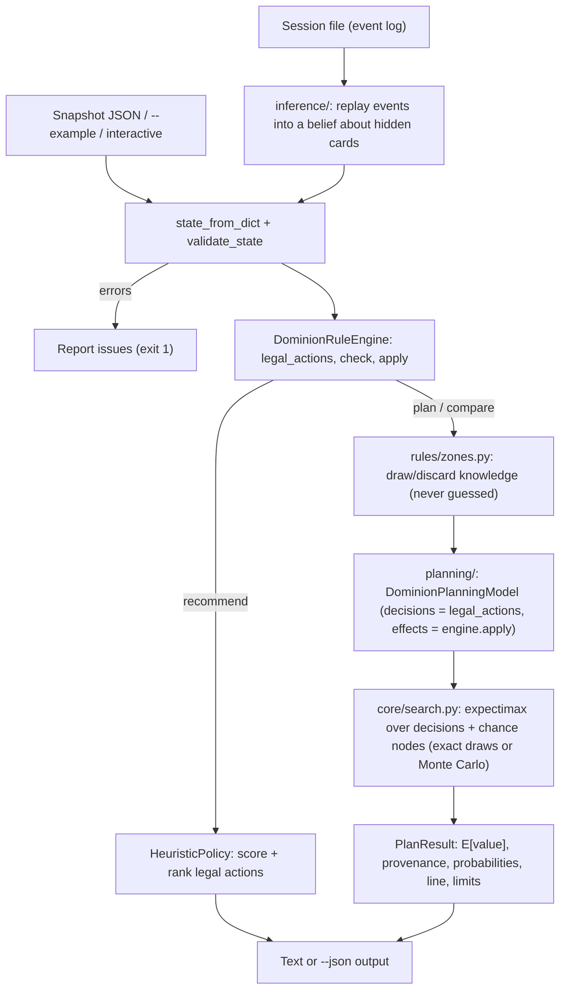

# Card Game Rule Engine

An **offline**, deterministic **rule engine** for card games with transparent, explainable
**decision policies** on top. It's built so an AI agent and more card games can be added later
without touching existing rule logic.

| Game | Ruleset | Status |
|------|---------|--------|
| `dominion` | Dominion Second Edition, Base Set, 2–4 players | Rule engine, heuristic policy, lookahead planner, game tracking with deck inference, CLI |

For Dominion, describe your current turn (or load a JSON snapshot) and it will:

1. check the snapshot against the official rules,
2. list every legal move (and explain why other moves are illegal),
3. rank the legal moves with a heuristic policy you can inspect line by line,
4. show a plan for the rest of the phase, a confidence level, and what it doesn't know,
5. look ahead through the rest of the turn with exact draw probabilities when you tell it what is in
   your draw and discard piles (`cardgame dominion plan` / `compare`),
6. track a real game turn by turn from the starting deck: you enter only what it cannot deduce, and it
   keeps an exact belief about your hidden cards, deck contents and draw odds (`cardgame dominion session ...`).

No internet, API, or LLM is used at runtime. All rule and card data is bundled in the package.



## Quick start

Requires **Python 3.10+**. No runtime dependencies (standard library only).

```bash
git clone https://github.com/Ashleyhx/Card-Game-Rule-Engine.git card-game-rule-engine
cd card-game-rule-engine

python -m venv .venv
source .venv/bin/activate          # Windows (PowerShell): .venv\Scripts\Activate.ps1

pip install -e ".[dev]"            # installs the `cardgame` CLI + pytest
```

Try it:

```bash
cardgame games                                             # list supported games
cardgame dominion examples                                 # list bundled example snapshots
cardgame dominion recommend --example village_smithy_action
cardgame dominion plan --example stranded_draw_vs_money    # lookahead planner
cardgame dominion interactive --save game.json            # guided advice, one turn at a time
cardgame dominion session interactive game.session.json    # track a real game turn by turn
pytest                                                     # run the test suite
```

Without installing: `PYTHONPATH=src python -m card_game_engine dominion recommend --example opening_5_2`.
Offline install: `pip install --no-build-isolation -e .` (needs `setuptools` already installed).

## Commands (Dominion)

All game commands are `cardgame <game> <command>`; add `--help` to any of them for every option.

| Command | What it does |
|---------|--------------|
| `recommend STATE.json` | Best move + alternatives with reasons |
| `legal STATE.json --explain` | Legal moves, and why other moves are illegal |
| `validate STATE.json` | Rule-consistency check (exit code 1 if invalid) |
| `interactive` | Step-by-step snapshot builder, then play and buy advice |
| `examples [--show NAME]` | List bundled examples / print one as a template |
| `cards [NAME]`, `sources` | Browse the verified card registry and research sources |
| `plan STATE.json`, `compare STATE.json` | Lookahead planner: actions by expected value with exact draw odds |
| `analyze STATE.json --count N --target T` | Exact odds of drawing a card or type in the next N cards |
| `session <verb> FILE ...` | Track a real game across turns: record events, deduce hidden cards, deck analysis, draw odds, predictions, planning |

## Documentation

| Document | Contents |
|----------|----------|
| [docs/USAGE.md](docs/USAGE.md) | Example output, interactive mode, snapshot format, bundled examples, what is supported |
| [docs/HEURISTIC.md](docs/HEURISTIC.md) | How the heuristic policy scores and ranks moves |
| [docs/PLANNER.md](docs/PLANNER.md) | Lookahead planner: describing piles, objectives, provenance labels, limitations |
| [docs/SESSIONS.md](docs/SESSIONS.md) | Game tracking, belief state, deck analysis and draw odds |
| [docs/ARCHITECTURE.md](docs/ARCHITECTURE.md) | Layers, core contracts, adding another card game |
| [docs/DEVELOPMENT.md](docs/DEVELOPMENT.md) | Project layout and the test suite |
| [docs/BENCHMARKS.md](docs/BENCHMARKS.md) | Planner vs heuristic benchmark |
| [docs/RULES_RESEARCH.md](docs/RULES_RESEARCH.md) | Dominion rule research: sources, dates, verified rules |
| [docs/ROADMAP.md](docs/ROADMAP.md) | What's done and what's next |

## License

MIT, see [LICENSE](LICENSE).

Dominion is © Rio Grande Games / Donald X. Vaccarino. This is an unofficial fan tool. It
contains no rulebook text or card artwork, only mechanics summarised in original wording.
