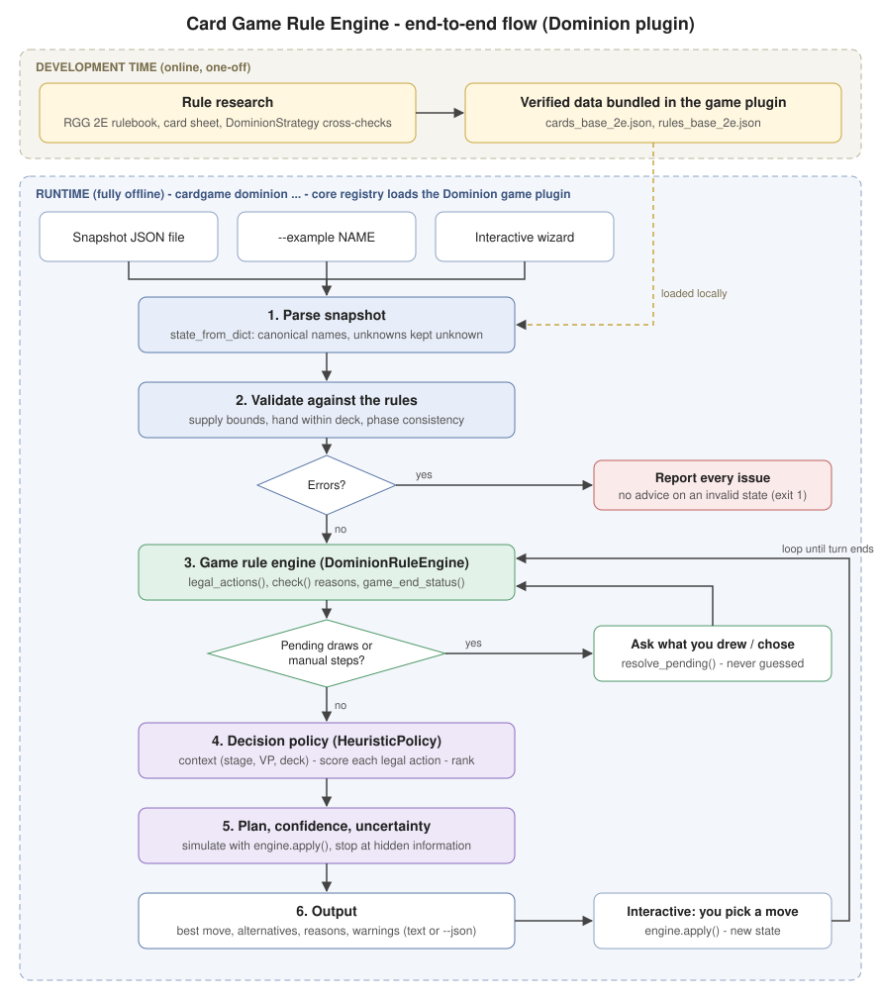
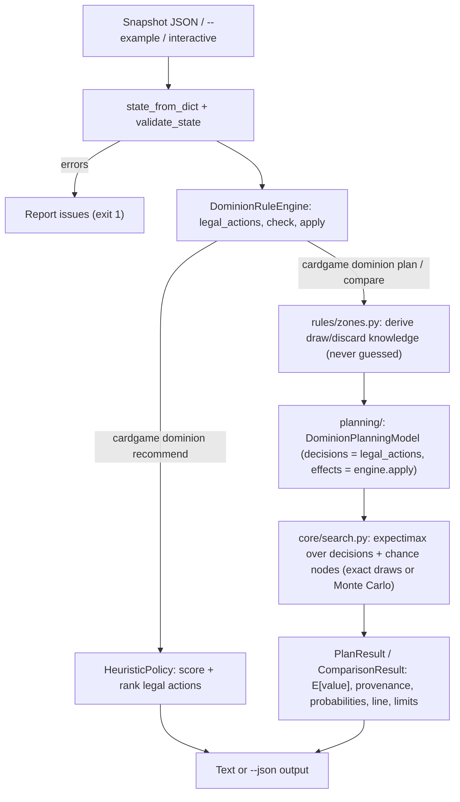

# Card Game Rule Engine

An **offline**, deterministic **rule engine** for card games with transparent, explainable
**decision policies** on top. It's built so an AI agent and more card games can be added later
without touching existing rule logic.

| Game | Ruleset | Status |
|------|---------|--------|
| `dominion` | Dominion Second Edition, Base Set, 2–4 players | V1 - rule engine + heuristic policy + CLI; Phase 2 - probabilistic lookahead planner; Phase 2b - session tracking & belief state |

For Dominion, describe your current turn (or load a JSON snapshot) and it will:

1. check the snapshot against the official rules,
2. list every legal move (and explain why other moves are illegal),
3. rank the legal moves with a heuristic policy you can inspect line by line,
4. show a plan for the rest of the phase, a confidence level, and what it doesn't know,
5. or (Phase 2) look ahead through the rest of the turn with exact draw probabilities when you tell it
   what is in your draw and discard piles (`cardgame dominion plan` / `compare`),
6. or (Phase 2b) track a real game turn by turn from the starting deck: you enter only what it cannot
   deduce, and it keeps an exact belief about your hidden cards (`cardgame dominion session ...`).

No internet, API, or LLM is used at runtime. All rule and card data is bundled in the package.
Dominion rule research sources and dates: [`docs/RULES_RESEARCH.md`](docs/RULES_RESEARCH.md).



The flowchart shows the V1 path. With the Phase 2 planner the runtime looks like this:



---

## Quick start

Requires **Python 3.10+**. No runtime dependencies (standard library only).

```bash
git clone <your-repo-url> card-game-rule-engine
cd card-game-rule-engine

python -m venv .venv
# macOS/Linux:
source .venv/bin/activate
# Windows (PowerShell):
.venv\Scripts\Activate.ps1

pip install -e ".[dev]"        # installs the `cardgame` CLI + pytest
```

Try it:

```bash
cardgame games                                             # list supported games
cardgame dominion examples                                 # list bundled example snapshots
cardgame dominion recommend --example village_smithy_action
cardgame dominion recommend --example endgame_penultimate_province
cardgame dominion plan --example stranded_draw_vs_money       # lookahead planner (Phase 2)
cardgame dominion interactive --save game.json            # guided advice turn after turn, by answering questions
cardgame dominion session interactive game.session.json    # track a real game turn by turn (Phase 2b)
pytest                                                     # run the test suite
```

Without installing, you can also run from the repo root:

```bash
PYTHONPATH=src python -m card_game_engine dominion recommend --example opening_5_2        # macOS/Linux
$env:PYTHONPATH="src"; python -m card_game_engine dominion recommend --example opening_5_2  # PowerShell
```

> Offline install: if the machine has no internet, use `pip install --no-build-isolation -e .`
> (needs `setuptools` already installed). Tests need `pytest`.

---

## Commands (Dominion)

All game commands are `cardgame <game> <command>`; `cardgame games` lists games.

| Command | What it does |
|---------|--------------|
| `cardgame dominion recommend STATE.json` | Best move + alternatives with reasons. `--json`, `--top N`, `--brief`, `--example NAME`, `-` for stdin |
| `cardgame dominion legal STATE.json --explain` | Legal moves, and why each unaffordable/empty buy is illegal |
| `cardgame dominion validate STATE.json` | Rule-consistency check (exit code 1 if invalid) |
| `cardgame dominion interactive [--save s.json] [--load s.json]` | Step-by-step snapshot builder, then live play and buy advice, turn after turn |
| `cardgame dominion examples [--show NAME]` | List examples / print one as a template |
| `cardgame dominion cards [NAME] [--kingdom]` | Browse the verified card registry (with sources) |
| `cardgame dominion sources` | Research sources and dates |
| `cardgame dominion plan STATE.json` | Lookahead planner: next action by expected value with exact draw odds (see [below](#lookahead-planner-phase-2)) |
| `cardgame dominion compare STATE.json [--actions LABEL ...]` | Every legal first action (or the listed ones) evaluated side by side by the planner |
| `cardgame dominion session <verb> FILE ...` | Track a real game across turns: record events, deduce hidden cards, predict hands, plan (see [below](#session-tracking--belief-state-phase-2b)) |

Example output:

```
>> RECOMMENDED: Play Throne Room on Smithy    [confidence: high]
     [+4.5] Smithy #1: +3 card(s) drawn.
     [+4.5] Smithy #2: +3 card(s) drawn.
     Throne Room: the doubled card does not use Actions.
     Uses your last Action: Moneylender will stay in hand.

Alternatives:
   2. Play Throne Room on Moneylender              score    5.40
   3. Play Smithy                                  score    4.50

Plan for this phase: Play Throne Room on Smithy -> Then: Draw 6 card(s) and add them
to your hand before continuing. Re-run the recommendation with your new hand.
```

### Interactive mode

`cardgame dominion interactive --save game.json` asks about player count, kingdom (the rulebook's
First Game set or your own 10 cards) and your turn number.

- **Turn 1 or 2: quick start.** You still hold the starting 7 Copper + 3 Estate, so it only asks how
  many Coppers are in your hand (and, on turn 2, what you bought on turn 1).
- **Later turns:** changed Supply piles, hand, cards already played, your deck (starting deck +
  changes like `+Silver x2, -Estate`) and opponents' VP. Coins are asked only if you have already
  played cards: Treasures still in your hand are added when the tool plays them.

It then recommends a move. Press Enter to apply it (or type an option's number). If the move draws
cards, it asks what you drew. If a card needs your choices (Chapel, Remodel, Witch's attack...),
it lists the steps and asks for the result. It never guesses.

When your turn ends it asks what each opponent gained or trashed (e.g. `Province`, `-Estate`; blank =
nothing), whether you gained anything on their turns (e.g. `+Curse`), and your new hand, then keeps
going until the game ends. Supply piles and opponents' VP update from what you enter; the kingdom,
your deck and a per-turn list of what you bought carry over. With `--save` the game is written after
every turn, so you can stop and resume with `cardgame dominion interactive --load game.json --save game.json`.

To try a game already in progress:

```bash
cardgame dominion examples --show saved_game_turn_3 > game.json
cardgame dominion interactive --load game.json --save game.json
```

---

## Snapshot format (schema v1)

Only `num_players`, `kingdom` and `player.hand` / `player.phase` are required. Anything
omitted is treated as **unknown** and reported as such. It is never made up.

```jsonc
{
  "schema_version": 1,
  "num_players": 2,                        // 2-4
  "turn_number": 9,                        // optional
  "kingdom": ["Cellar", "Chapel", "Village", "Smithy", "Throne Room",
              "Moneylender", "Festival", "Laboratory", "Market", "Witch"],
  "supply": {"Province": 8, "Curse": 6},   // optional; missing piles are assumed full (flagged)
  "trash": ["Copper"],                     // optional
  "player": {
    "phase": "buy",                        // "action" | "buy" ("turn_over" in saved games)
    "hand": ["Gold", "Silver", "Copper", "Copper", "Estate"],   // or {"Copper": 2, ...}
    "in_play": [],                         // cards already played this turn
    "actions": 1, "buys": 1, "coins": 0,   // current remaining resources
    "bought_this_turn": [],
    "owned_cards": {"Copper": 7, "Estate": 3, "Silver": 3, "Gold": 1, "Witch": 1},  // optional: whole deck
    "deck_count": 4, "discard_count": 8     // optional
  },
  "opponents": [{"name": "Opponent", "vp": 0}],  // optional; vp or owned_cards
  "history": [{"turn": 1, "hand": ["Copper", "Copper", "Copper", "Estate", "Estate"], "bought": ["Silver"]}]
                                           // optional; written by `interactive --save`
}
```

Tip: `cardgame dominion examples --show witch_midgame_buy > my_turn.json` gives you a template.
For the lookahead planner you can also describe your draw and discard piles (`player.draw_pile`,
`player.discard_pile`) and a default horizon (`planning`), see [docs/PLANNER.md](docs/PLANNER.md#describing-your-piles-snapshot-fields-all-optional).

### Bundled examples

| Name | Situation |
|------|-----------|
| `opening_5_2` | Turn 1, five Coppers |
| `village_smithy_action` | Action sequencing (Village before Smithy) |
| `throne_room_moneylender` | Which card to Throne |
| `witch_midgame_buy` | $7 with a Witch kingdom: Witch vs Gold (low-confidence close call) |
| `multi_buy_festival` | 3 Buys, $10 to split (3-player) |
| `endgame_penultimate_province` | $8 but behind: Penultimate Province Rule → Duchy |
| `endgame_winning_province` | Last Province wins the game |
| `three_pile_ending` | Ending the game on piles while ahead |
| `unknown_deck_minimal` | Minimal info: shows how uncertainty is reported |
| `saved_game_turn_3` | Saved 3-player game with turn history: continue it in interactive mode |
| `small_deck_village_smithy` | Planner: known 5-card draw pile, Village→Smithy E[$]=5.20 vs Smithy first 4.40 |
| `stranded_draw_vs_money` | Planner: draw pile of Estates, Militia ($5) beats Smithy ($3); the heuristic picks Smithy |
| `ordered_deck_known` | Planner: fully known draw order, Village→Smithy reaches exactly $8 |
| `reshuffle_next_hand` | Planner, `next_hand` horizon: the next hand reshuffles a known discard pile |
| `partial_knowledge` | Planner: known top card + unknown cards, values reported as lower bounds |

---

## What V1 supports

**Rules (verified against the publisher's 2E rulebook):** setup pile sizes for 2–4 players;
Action → Buy → Clean-up; Action/Buy accounting; coin pooling across Buys; $0 buys; the 2E rule
that **Treasures cannot be played after buying**; empty piles; game end (Provinces empty or 3
piles empty, checked at end of turn); VP including Gardens.

**Cards:** all 7 basic cards and all 26 Base Set 2E Kingdom cards are in the registry with cost,
types and effects. Support level per card (`cardgame dominion cards`):

- **full**: deterministic effects applied automatically (Village, Smithy, Laboratory, Market,
  Festival, Moat, Merchant's Silver bonus, Moneylender's trash choice, all Treasures/Victory cards)
- **partial**: numeric part automated, the rest is a manual step (Witch, Militia, Throne Room,
  Library, Poacher, Bandit, Bureaucrat, Council Room, Cellar, Harbinger, Vassal, Sentry)
- **manual**: Chapel, Workshop, Remodel, Mine, Artisan (the engine asks you for the result)

Draws are always **pending** until you say what you drew. That's hidden information.

**Not supported in V1:** 5–6 players, expansions, opponents' turns and Moat reactions,
deck tracking / shuffle inference (the Phase 2 planner uses draw/discard piles you describe,
but does not track them across turns). See [`docs/RULES_RESEARCH.md`](docs/RULES_RESEARCH.md).

## How the Dominion heuristic policy decides

Scores are sums of **named components** printed next to each option, e.g.
`[+14.0] Province baseline value in the endgame stage` and
`[-8.0] Penultimate Province Rule: ...`. The components are:

- game **stage** (early → mid → dance → late → endgame) from Provinces left and pile pressure
- basic-card values by stage (Big-Money-style buy rules)
- a 0–10 Kingdom strength rating, discounted late in the game
- deck fit: terminal collision, villages without terminals, duplicates, Curses left for Witch, etc.
- endgame safety: winning/losing game-ending buys, Penultimate Province Rule, 3-pile warnings
- Action-phase sequencing: non-terminals before terminals, value of draws/coins/buys/attacks

All numbers live in [`src/card_game_engine/games/dominion/policy/weights.py`](src/card_game_engine/games/dominion/policy/weights.py).
They are **heuristics, not rules**. Confidence comes from the score gap to the next option. It
drops when the deck or scores are unknown. Every output lists its uncertainties.


## Lookahead planner (Phase 2)

`cardgame dominion plan` looks ahead through the rest of your turn (optionally until your next hand is
drawn) and picks the action with the best **expected value**. Card effects come only from the rule
engine (`legal_actions` / `apply`); the planner adds **chance nodes** for draws, whose outcomes it
enumerates exactly (multivariate hypergeometric, grouped by multiset), including the reshuffle when
the draw pile runs out. It falls back to seeded Monte Carlo sampling only when a draw has more than
200 distinct outcomes. It never invents hidden cards: a card of unknown identity stays `"?"`.

Pile descriptions, objectives, provenance labels, worked examples and limitations:
**[docs/PLANNER.md](docs/PLANNER.md)**.

## Session tracking & belief state (Phase 2b)

Instead of describing a snapshot every turn, you can track one real game from the start. The engine
loads the standard starting deck (7 Copper, 3 Estate, shuffled: composition known, order unknown),
and you record **only what it cannot deduce**: your hand when it is uncertain, your plays and buys,
cards gained/trashed/discarded, and Supply counts you want to correct. The session file is just the
event log (`Session.to_dict()` JSON); every command replays it from the start, so results are
reproducible, and writes are atomic.

```bash
cardgame dominion session start game.session.json
cardgame dominion session hand game.session.json "4 Copper, Estate"
cardgame dominion session predict game.session.json
cardgame dominion session interactive game.session.json    # or all verbs in one prompt
```

Session files use the `.session.json` extension so they never get mixed up with snapshot files
(and `*.session.json` is gitignored). All verbs, labels, worked examples and limitations:
**[docs/SESSIONS.md](docs/SESSIONS.md)**.

## Project layout

```
pyproject.toml
src/card_game_engine/
  core/          game-agnostic contracts (RuleEngine, Policy, GameAction, Transition, GameDefinition) + registry;
                 search.py: generic expectimax + Monte Carlo with budgets (Phase 2);
                 session.py: initialize_session(domain, config) dispatch (Phase 2b)
  cli.py         `cardgame <game> <command>` entry point
  games/
    dominion/    first game plugin
      data/      cards_base_2e.json, rules_base_2e.json  (verified research output)
      rules/     DominionRuleEngine: cards, ruleset, state, actions, engine, validation, zones (pile knowledge)
      policy/    HeuristicPolicy: context, weights, scoring
      planning/  lookahead planner: draws, transitions, evaluation (objectives), planner (public API)
      inference/ session tracking (Phase 2b): events, belief (weighted worlds), replay (applies one event),
                 session (public API)
      cli/       commands, interactive assistant, session_cli (`session` verbs), parsing, rendering
      examples/  bundled example snapshots
benchmarks/      planner_vs_heuristic.py
tests/
  test_core.py   registry, interface conformance, a game-agnostic agent-style loop
  test_search.py, test_benchmark.py   generic search, benchmark smoke test
  dominion/      cards/setup, engine, state, zones, draws, transitions, planner, inference, policy, CLI,
                 session CLI, offline check
docs/            ARCHITECTURE.md, PLANNER.md, SESSIONS.md, BENCHMARKS.md, RULES_RESEARCH.md, flowchart.svg
```

Rule engines never import policies, and `core` imports no game. To add a new card game,
follow the six steps in [`docs/ARCHITECTURE.md`](docs/ARCHITECTURE.md#adding-another-card-game):
make a `games/<id>/` package, implement the core contracts, expose `GAME`, and register it.

## Roadmap

**Done in Phase 2 (v1.2.0):**

- Search-based planner: game-agnostic expectimax in `core/search.py`, Dominion model in `planning/`,
  using only `legal_actions` + `apply` from the rule engine.
- Exact draw probabilities from a draw/discard knowledge model (`rules/zones.py`), with reshuffles,
  and seeded Monte Carlo fallback with standard errors.
- Objectives with provenance labels (exact / expected / monte_carlo / heuristic / lower_bound / partial),
  `cardgame dominion plan` / `compare`, examples and a benchmark against the heuristic.

**Done in Phase 2b (v1.3.0):**

- Session tracking from the standard starting deck (or a partial mid-game snapshot): typed events,
  exact Bayesian belief over hidden zones (weighted worlds), contradiction vs incomplete-history
  detection, correct/undo/reset with full replay (`inference/`, `core/session.py`).
- Exact cross-turn next-hand predictions (reshuffles, purchases, correlations between turns).
- Planner: multi-hand horizon `hands:N` + `future_money` objective, explicit tie reporting.
- `cardgame dominion session ...` verbs and an interactive session REPL.

**Next (not implemented yet):**

1. **TODO: one game file for `interactive` and `session`.** Today both track a game across turns:
   `interactive` keeps its own per-turn `history` in a snapshot (it is the only one that advises what to
   *buy*), while `session` keeps an event log with a belief about your hidden cards. Rebuild
   `interactive`'s multi-turn loop on top of `Session`: record each turn's hand, plays and buys as session
   events, ask only for the next hand (skip it when the belief already deduces it), and keep the play and
   buy advice. One save file then works with both commands, and the snapshot `history` field can go.
2. **Exact belief-aware planning over mixtures**: search over the weighted worlds directly instead of
   the conservative `?` approximation, with decisions that depend on newly observed cards.
3. **Opponent modelling**: opponents' turns, attacks on you, Moat reactions, Supply depletion.
4. **LLM agent orchestration**: expose `initialize_session` / `record_event` / `predict_next_hand` /
   `plan_next_action` plus `legal_actions` / `check` / `apply` as tools (all JSON-serialisable).
   The agent proposes, the rule engine checks.
5. **More card games**: new plugins under `games/` (see the guide in ARCHITECTURE.md).
6. **Screenshot-based state recognition**: produce snapshots from images via `parse_state`.
7. **External game adapters**: e.g. read state from online play logs.
8. **General decision environment**: `parse_state` + `legal_actions` + `apply` as an env API.
9. Dominion: 5–6 players, Intrigue and later expansions.

## Running the tests

```bash
pytest -q
```

The suite covers the core registry and interfaces (including a game-agnostic
agent-style loop), and for Dominion: every card's cost/effect against the research, setup sizes for 2/3/4 players,
legal-action enumeration and constraint messages, transitions (Merchant, Throne Room,
Moneylender, Poacher, Library, Bandit...), end-of-game detection and scoring, snapshot
validation, policy behaviour on each example, CLI commands, interactive mode with scripted
input, and a check that the runtime makes **no network calls**. Phase 2 adds the generic search,
zone derivation, exact draw enumeration (probabilities sum to 1), card conservation in transitions,
hand-verifiable planner values (e.g. Village→Smithy E[$]=11/3), lower-bound / partial labelling,
the `plan` / `compare` commands and a benchmark smoke test.

---

Dominion is © Rio Grande Games / Donald X. Vaccarino. This is an unofficial fan tool. It
contains no rulebook text or card artwork, only mechanics summarised in original wording.
