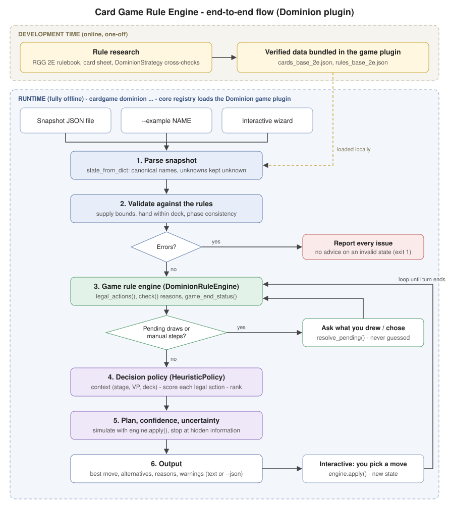

# Architecture



## Layers

```
card_game_engine/
├── core/                    GAME-AGNOSTIC: contracts every game implements + registry
│   ├── interfaces.py          RuleEngine, Policy, GameAction protocols; Transition; IllegalActionError;
│   │                          GameDefinition (how a game plugs in)
│   ├── registry.py            available_games(), get_game("dominion")
│   └── search.py              generic expectimax + Monte Carlo with depth/node budgets (PlanningModel protocol)
├── cli.py                   `cardgame <game> <command>` - dispatches to each game's commands
└── games/
    └── dominion/            GAME PLUGIN: Dominion 2E Base Set  (exposes GAME = GameDefinition)
        ├── data/              Verified card + rule data (JSON research output)
        ├── rules/             RULE ENGINE - legality only, no strategy, no I/O
        │   ├── cards.py         CardDef / CardRegistry
        │   ├── ruleset.py       setup sizes, end conditions
        │   ├── state.py         GameState / TurnState + snapshot (de)serialisation
        │   ├── actions.py       PlayAction, EndActionPhase, PlayTreasure, PlayAllTreasures, Buy, EndTurn
        │   ├── engine.py        DominionRuleEngine: legal_actions, check, apply, resolve_pending, game_end_status
        │   ├── validation.py    rule-level snapshot consistency checks
        │   └── zones.py         draw/discard pile knowledge + deterministic zone rules (reshuffle, clean-up)
        ├── policy/            DECISION POLICY - ranks what the engine says is legal
        │   ├── context.py       derived facts: stage, VP, deck stats, unknowns
        │   ├── weights.py       every strategy number in one place (heuristics, not rules)
        │   ├── scoring.py       score = sum of named, explained components
        │   └── heuristic.py     HeuristicPolicy: rank(), plan(), recommend() -> Recommendation
        ├── planning/          LOOKAHEAD PLANNER (Phase 2) - expected values over exact draw outcomes
        │   ├── draws.py         exact grouped draw enumeration (hypergeometric) + seeded sampling
        │   ├── transitions.py   PlanState + pure simulate_* transitions (engine.apply + zone updates)
        │   ├── evaluation.py    leaf metrics + objectives (money, threshold:N, next_hand_money, purchase)
        │   └── planner.py       DominionPlanningModel; plan_next_action, evaluate_action_sequences, compare_actions
        ├── cli/               `cardgame dominion ...` commands, interactive assistant, rendering
        └── examples/          bundled snapshots
```

Dependencies only point one way: `cli → policy → rules → data` and `cli → planning → rules`
(`planning` also reads `policy` weights, only for the heuristic `purchase` objective), and every
game depends on `core`. `core` imports no game (the registry loads games lazily by module path).
A rule engine never imports a policy or the planner.

## Core contracts (`card_game_engine.core`)

| Contract | Purpose |
|----------|---------|
| `RuleEngine.legal_actions(state) -> list[Action]` | The only source of legality. Policies/agents choose from this list. |
| `RuleEngine.check(state, action) -> list[str]` | Human-readable reasons an action is illegal (empty = legal). |
| `RuleEngine.apply(state, action) -> Transition` | Pure transition: returns a *new* state + notes. Raises `IllegalActionError`. |
| `RuleEngine.blocking_issues(state)` | Hidden info / manual steps that must be resolved before continuing. |
| `Policy.recommend(state)` | Ranks legal actions. The V1 policy is heuristic. |
| `GameAction` | Immutable action with `kind` and `describe()`. |
| `GameDefinition` | `id`, `name`, `ruleset`, `create_engine`, `create_policy`, `parse_state`, `register_cli`. |

`tests/test_core.py::test_game_agnostic_loop_uses_only_core_contracts` shows the loop a
future agent runs: ask a policy → check the action is in `legal_actions` → `apply` →
stop when `blocking_issues` says hidden information is needed.

## Adding another card game

1. Create `src/card_game_engine/games/<id>/` with its own `data/`, `rules/`, `policy/`, `cli/`.
2. Implement a rule engine with `legal_actions`, `check`, `apply` (returning
   `core.Transition`) and `blocking_issues`, plus at least one policy with `recommend`.
3. Expose `GAME = GameDefinition(id="<id>", ...)` in the package `__init__.py`.
4. Add `"<id>": "card_game_engine.games.<id>"` to `_GAME_MODULES` in `core/registry.py`.
5. Add its JSON files to `[tool.setuptools.package-data]` in `pyproject.toml`.
6. Put tests in `tests/<id>/`. `cardgame <id> ...` will work immediately.

## Hidden information policy

A rule engine never guesses. In Dominion, `+N Cards` increments `pending_draws`. Effects
with player choices or hidden knowledge (Chapel, Remodel, Witch's attack, Vassal's reveal...)
go to `unresolved`. While either is non-empty, `legal_actions()` returns `[]` and the CLI
asks the user what happened. So every state the engine reasons about is *true*.

## Lookahead planner (Phase 2)

Three layers, each usable on its own:

1. **`core/search.py` (game-agnostic).** `expectimax(model, root, SearchConfig)` searches any game
   that implements the `PlanningModel` protocol: `decisions`, `apply`, `is_chance`, `outcomes`
   (exact `(p, child, label)` list, or `None` when there are too many), `sample`, `is_terminal`,
   `evaluate`, `key`, `action_key`. Decision nodes take the max, chance nodes the exact
   probability-weighted sum or a Monte Carlo mean with a standard error. Depth counts decision
   steps; the node budget is shared fairly between root actions; exact subtrees are cached by
   `(key, remaining depth)`; each root action has its own RNG seeded by `f"{seed}:{action_key}"`.
   Results are best-under-budget (`ActionValue`, `SearchStats`); nothing claims optimality.
2. **`dominion/rules/zones.py` (rules, no probabilities).** `DrawPileKnowledge` (known top prefix,
   known multiset, unknown `"?"` count, or size unknown) and `DiscardKnowledge`, the rulebook's
   reshuffle and clean-up as pure functions, and `derive_zone_knowledge(state)`, which only uses
   exact subtraction (owned cards minus visible zones) and reports how it derived each pile.
   `InformationLevel` = `fully_known_order` / `known_composition` / `partially_known` / `insufficient`.
3. **`dominion/planning/*` (the Dominion model).** `draws.py` enumerates draw outcomes by multiset
   (probabilities are exact `Fraction`s summing to 1; reshuffles included; an unknown pile becomes an
   `unknown_draw_pile` boundary). `transitions.py` applies decisions through `engine.apply` and draw
   outcomes through `engine.resolve_pending`, never re-implementing card effects; manual choices
   become `manual:<card>` boundaries. `evaluation.py` turns leaves into metrics and objectives.
   `planner.py` implements `PlanningModel` (`decisions` = `engine.legal_actions`, with documented
   Buy-phase reductions) and builds JSON-serialisable results with provenance labels: `exact`,
   `expected`, `monte_carlo`, `heuristic`, `lower_bound` (unknown cards counted as $0) and
   `partial` (an unmodelled player choice evaluated as if it did nothing).

The CLI (`cardgame dominion plan` / `compare`) only parses arguments and renders these results.

### Calling the planner from an agent

A future LLM agent can use the planner as tools; everything goes through JSON:

```python
from card_game_engine.games.dominion.planning import PlanConfig, compare_actions, plan_next_action
from card_game_engine.games.dominion.rules import DominionRuleEngine, state_from_dict

engine = DominionRuleEngine()
state = state_from_dict(snapshot_dict)                       # the agent's observation
plan = plan_next_action(state, PlanConfig(objective="money", seed=0), engine).to_dict()
# plan["recommended"]["action"] is an action dict (always one of engine.legal_actions(state));
# plan["limitations"], ["value_provenance"] and ["threshold_provenance"] say how far to trust it.
cmp = compare_actions(state, [{"kind": "play_action", "card": "Village"},
                              {"kind": "play_action", "card": "Smithy"}], engine=engine).to_dict()
```

The agent proposes, the engine checks (`engine.check` / `apply`), and the planner quantifies:
illegal candidates come back with the engine's reasons instead of a value, and a blocked state
(pending draws, manual steps) gets no recommendation.

## How future phases plug in (not implemented yet)

- **LLM tool-calling agent:** expose `get_game(id)`, `legal_actions`, `check`, `apply`,
  `recommend`, `plan_next_action` and `compare_actions` as tools. Actions and planner results
  already serialise to JSON (`action_to_dict` / `action_from_dict`, `to_dict()`).
- **Deeper multi-turn planning / opponent modelling:** extend the Dominion `PlanningModel`
  (zone knowledge across turns, opponents' turns as chance or decision nodes); `core/search.py`
  needs no changes.
- **Screenshot recognition / external game adapters:** produce a snapshot dict and pass it
  through `GameDefinition.parse_state` (+ the game's validation).
- **General decision environments:** `parse_state` + `legal_actions` + `apply` already form
  an environment interface (observation, action space, transition).
